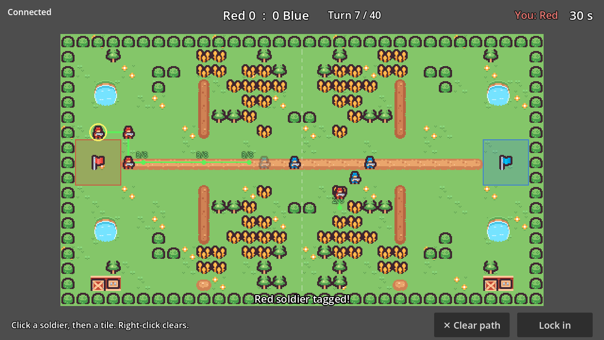

# Tiny Flag

**Core loop:** two teams of five on a small farm map play capture the flag in simultaneous turns. Each turn both sides plan a path for every piece (30 s, or until both lock in), the server resolves the turn in 8 lockstep ticks (tags, pickups, captures), and both sides watch the playback before the next turn starts. Fog of war is enforced on the server: a side is only ever sent the enemies it can see. First to 3 captures wins; after 40 turns the higher score wins (or it's a draw). The full rules are in `docs/superpowers/specs/2026-10-27-tiny-flag-design.md`.

**Players:** 1v1. The first two people take Red and Blue; a side with nobody on it is played by the server's bot, and a person who joins later takes a bot's side at the next turn start. Everyone else watches as a spectator, one turn behind (so a spectator can never tell a player what that player couldn't see). **Dimension:** 2D. **Port:** 9082 (`Protocol.PORTS["flag"]`, the default game).

**Kenney packs:** *Tiny Farm* (paths, wheat, trees, hedges, barns) and *Tiny Battle* (grass, ponds, soldiers, flags), both CC0 under `assets/kenney/`. Every tile index is a constant in `client/flag_art.gd`, the only file that names Kenney paths.

**Controls:** mouse: click a soldier, click a tile to plan its path (green within its points, red over), click again to extend from the path's end; right-click or ✕ Clear clears it. Touch: tap a soldier, tap a tile to preview, tap it again to confirm. Lock in sends the orders early; every change is sent again until the timer ends. Esc / Start / the touch Menu button goes back to the menu.

| File | Runs on | Does |
|---|---|---|
| `tiny_flag_game.gd` | both | `TinyFlagGame`: the RPCs (`submit_orders`, `lock_in`, `playback_done` up; `turn_started`, `turn_resolved`, `match_over` down), the server's `FlagMatch`, client signals, client bot and smoke report |
| `flag_person.gd` | both | `FlagPerson`: the marker node GameBase spawns per person |
| `flag_client_tally.gd` | client | smoke checks from what the client was sent: turns, leaked enemies, own pieces moved |
| `flag_match.gd` | server | `FlagMatch`: phases, planning timer, sides, bots, spectators (no nodes; unit-tested) |
| `flag_sides.gd` | server | who plays which side, who waits, who watches |
| `sim/` | both | pure rules: `FlagMap`, `FlagState`, `FlagPath` (orders), `FlagVision`, `FlagResolver`, `FlagWire` (what each side is sent), `FlagBot` |
| `client/flag_client.gd` | client (people) | `FlagClient`: wires the game's messages to the board, orders and HUD; sends orders, lock-in and `playback_done` after the playback (bots skip all of it and stay headless) |
| `client/board_view.gd` | client | `BoardView`: terrain, pieces, flags, faded last-seen markers, playback (0.3 s per tick), `tile_at`; fits the board at a whole zoom |
| `client/board_terrain.gd`, `client/board_overlay.gd` | client | painting the map into two `TileMapLayer`s; bases, halfway line and planned paths with their costs |
| `client/order_model.gd`, `client/order_input.gd` | client | `OrderModel` (pure: selection, paths, budgets, wire orders); `OrderInput` (mouse and touch to `OrderModel`) |
| `client/turn_hud.gd`, `client/flag_menu.gd` | client | `TurnHud` (score, turn, countdown, Lock in, ✕ Clear, event toasts, result); `FlagMenu` (Play, Controls) |
| `client/flag_art.gd` | client | `FlagArt`: Kenney sheets and tile indices |
| `maps/farm.txt` | both | the map, as text (exported via `include_filter` in `export_presets.cfg`) |

## Why it doesn't use InputRelay, PlayerNet or ServerBots

These are deliberate, so don't "fix" them back:

- **`InputRelay` / `PlayerNet` / `SnapshotBuffer`:** a turn game has no input stream and nothing to interpolate. Pieces are not synced nodes; the client draws them from the turn messages, which are already filtered per side for fog of war (a synchronizer would send every piece to everyone).
- **`ServerBots`:** the bot side lives inside `FlagMatch` and plays without a seat, so a person joining always takes over a bot's side at the next turn start instead of waiting for a seat to free up.
- `GameBase` still does seats, join requests, back-to-select, rejoin after a lost connection and smoke reporting. `TinyFlagGame` overrides `_process`, `_player_leaving` and `smoke_report`, whose base versions assume moving players.

## Smoke test

`tools/smoke.sh flag` runs the server with two bot clients. The server passes when at least 3 turns resolved, both teams moved and no person's order was invalid. Each client passes when it played back at least 3 turns, one of its own pieces moved, it was never sent an enemy its pieces couldn't see (`leaks: 0`, checked on every tick), and its trip back to select ended in a fresh spawn.
